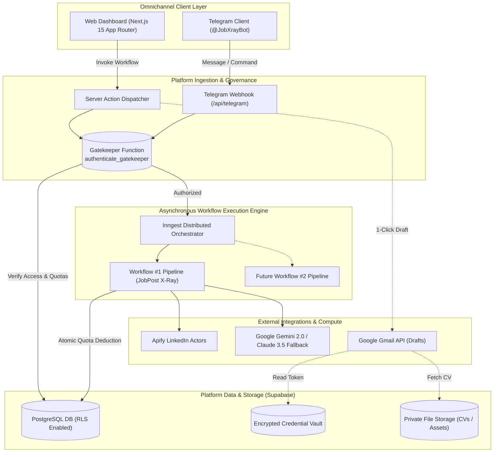
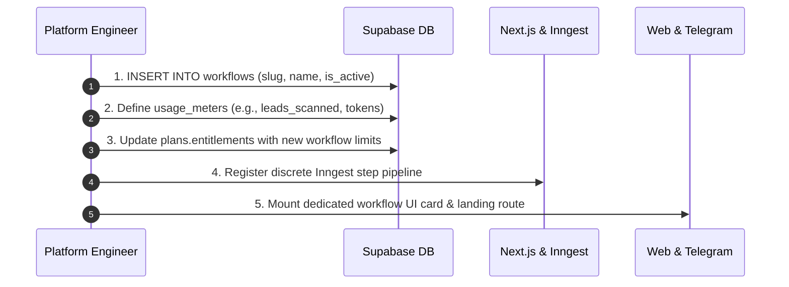

# 🌐 EpiFlow Platform: Project Architecture & Stakeholder Brief

> **Executive Summary:** EpiFlow is an enterprise-grade SaaS platform built to deploy, govern, and monetize specialized, autonomous AI workflows. While designed as an extensible multi-workflow ecosystem sharing unified authentication, billing, and multi-channel dispatch, the platform launches with its flagship workflow: **JobPost X-Ray** (`job-xray`).

---

## 1. Platform Taxonomy & Core Thesis

```
                          ┌────────────────────────────────────────────────────────┐
                          │               EPIFLOW PLATFORM CORE                    │
                          │   Auth (Google) • Billing (Stripe) • Gatekeeper Engine │
                          │   Multi-Meter Usage Tracking • Channel Dispatchers    │
                          └──────────────────────────┬─────────────────────────────┘
                                                     │
            ┌────────────────────────────────────────┼────────────────────────────────────────┐
            ▼                                        ▼                                        ▼
   ┌──────────────────┐                     ┌──────────────────┐                     ┌──────────────────┐
   │   WORKFLOW #1    │                     │   WORKFLOW #2    │                     │   WORKFLOW #N    │
   │  JobPost X-Ray   │ (Active Launch)     │  Lead Enriched   │ (Planned)           │  Custom B2B Flow │ (Future)
   │  Slug: job-xray  │                     │  Slug: lead-xray │                     │  Slug: custom-*  │
   └──────────────────┘                     └──────────────────┘                     └──────────────────┘
```

### The Strategic Vision: "Workflows as Products"
Instead of building isolated, one-off micro-SaaS tools, **EpiFlow provides the foundation and runtime** for publishing targeted AI automations:
- **Unified Infrastructure:** One user identity, one payment profile, and one secure credential vault power multiple specialized tools.
- **Decoupled Workflows:** Each workflow maintains its own dedicated user experience, landing page, processing pipeline, and consumption meters.
- **Entitlement-Based Monetization:** Subscriptions grant access to specific workflow catalogs and specific usage limits via database-enforced entitlements.
- **Phase 1 Priority:** Perfect and scale **Workflow #1 (JobPost X-Ray)** to 100% reliability, validating the end-to-end platform engine before onboarding subsequent workflows.

---

## 2. Platform Core Infrastructure (Reusable Engine)

The EpiFlow platform provides five centralized pillars that any current or future workflow inherits automatically:

| Platform Pillar | Database Source / Mechanism | Business & Architectural Function |
|---|---|---|
| **Gatekeeper & Access** | `authenticate_gatekeeper()` | Enforces user approval status, workflow licensing, expiration, and real-time quota checks before any compute runs. |
| **Multi-Meter Tracking** | `usage_meters` & `access_usage` | Replaces flat counters with granular, multi-dimensional consumption tracking (e.g., `runs`, `ai_tokens`, storage bytes). |
| **Entitlement Billing** | `plans.entitlements` | JSON-driven plan catalog mapping subscriptions to specific workflows and meter limits (e.g., 100 runs of `job-xray`). |
| **Channel Dispatch** | `workflow_channels` | Powers omnichannel interaction—triggering and delivering workflows via Web Dashboards, Telegram Bots, and future channels. |
| **Credential Vault** | `workflow_credentials` | Stores user-provided third-party OAuth tokens (e.g., Gmail Compose) encrypted at rest (AES-256-GCM / Supabase Vault). |

---

## 3. Flagship Workflow #1: JobPost X-Ray (`job-xray`)

The first production workflow deployed on EpiFlow solves recruitment and candidate friction on LinkedIn:

### Value Proposition
- **The Problem:** Job seekers face information overload, ghost postings, and miss out on direct hiring leads embedded in informal LinkedIn updates.
- **The Pipeline:** Accepts any LinkedIn URL (`posts`, `jobs`, `lnkd.in`), executes a **3-Layer Enrichment** (Post $\rightarrow$ Recruiter $\rightarrow$ Company), verifies direct application emails, and generates an AI structured report.
- **1-Click Gmail Outreach:** Automatically prepares a personalized application draft in the user's Gmail with their uploaded CV attached (zero auto-send; user keeps 100% control).
- **Bilingual MENA Moat:** Fully transcreated into contemporary Arabic (Cairo font, native RTL layout) alongside English.

### Unit Economics & Profitability (Workflow #1)
- **Blended Compute Cost per Run:** **~$0.020** (Apify scrapers + Gemini 2.0 Flash + serverless compute).
- **Pro Tier Subscription ($19/mo for 100 runs):** Maximum COGS is $2.00; Stripe fee is $0.85 $\rightarrow$ **$16.15 net gross profit (~85% margin)**.
- **Fail-Safe Quota Rule:** Quota is consumed via `consume_usage` *only* after a report is successfully delivered. Scrape failures burn zero user credits.

---

## 4. End-to-End System Architecture



---

## 5. Extensibility: How New Workflows Are Added

Adding a new workflow to EpiFlow requires **zero foundational changes** to authentication, payment infrastructure, or database structure:



### Future Workflow Candidates in the Pipeline:
1. **Prospect X-Ray (`prospect-xray`):** Scrapes company domains and decision-makers to build cold sales intelligence dossiers.
2. **Resume Match & Optimization (`cv-match`):** Compares candidate resumes against target role requirements with AI gap analysis.
3. **Executive Headhunter Monitor (`recruiter-pulse`):** Monitors hiring surges across competitor companies and sends weekly digest alerts.

---

## 6. Business Model & Platform Monetization

| Plan Tier | Target Price | Workflow Entitlements | Target Audience |
|---|---|---|---|
| **Free Trial** | $0 | 3 runs of `job-xray` | First-time trial candidates & organic traffic |
| **Pro Searcher** | **$19 / month** | 100 runs of `job-xray` + 1-Click Gmail Drafting | Active job seekers & individual consultants |
| **Platform All-Access** | **$39 / month** | All active workflows with unified monthly quotas | Freelancers, power users, and multi-tool operators |
| **Agency / Team** | **$99+ / month** | Multi-seat, shared team pools, priority Apify concurrency | Recruitment agencies & headhunting boutiques |

---

## 7. Security, Governance & Isolation Invariants

- **Multi-Tenant Data Isolation:** Row-Level Security (RLS) is enabled on all core tables. Users cannot read or manipulate another user's execution runs, CVs, or meters.
- **Least-Privilege Third-Party Access:** Google OAuth scopes are strictly limited to `gmail.compose` (cannot read or delete emails). Refresh tokens are AES-256-GCM encrypted.
- **Anti-Hallucination Guardrails:** Business logic enforces that LLMs cannot synthesize or guess contact information. Only explicitly scraped, regex-verified emails are utilized.
- **Asynchronous Execution Bounds:** Server actions operate strictly as dispatchers returning in `< 200ms`, delegating long-running jobs to the background queue to prevent platform timeouts.

---

## 8. Stakeholder Summary & FAQ

**Q: Why build a platform rather than a single-purpose tool?**  
*A:* Building single-purpose automation tools creates fragmented codebases and multiple subscription silos. EpiFlow captures higher customer lifetime value (LTV) by offering a growing suite of specialized workflows under one account and one billing relationship.

**Q: What is the current focus of the engineering team?**  
*A:* 100% of engineering bandwidth is currently dedicated to solidifying the **Next.js core architecture, database migrations, and Workflow #1 (JobPost X-Ray)**. Once this workflow is battle-tested and revenue-generating, subsequent workflows will be added seamlessly.
