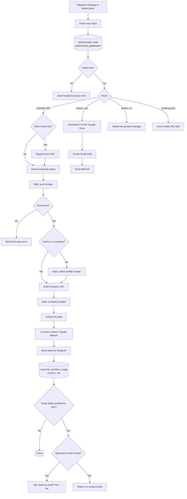

# 💼 JobPost X-Ray for LinkedIn

An workflow that turns a LinkedIn job post into a clear, scannable report inside Telegram. Send the bot a LinkedIn link and it scrapes the post, the person who posted it, and the company behind it, then uses AI to write a localized (Arabic or English) summary. If the post names an application email, the bot can also prepare a Gmail draft with your CV attached.

Access is controlled by a PostgreSQL gatekeeper: only approved users can run it, and each user has an optional per-workflow usage quota that is only consumed when a report is delivered successfully.

## Features

- **Telegram interface:** paste a LinkedIn post, job, or `lnkd.in` short link and get a report back.
- **Three-stage enrichment:** post content, then the poster's profile, then the company profile (via Apify).
- **AI report in Arabic or English:** role summary, responsibilities, requirements, how to apply, poster background, company details, and a short list of factual flags. Arabic replies are sent right-to-left.
- **Automatic model fallback:** Google Gemini first, Claude Sonnet as the fallback.
- **Optional Gmail draft:** if (and only if) the post explicitly names an application email, the bot offers to create a draft with your CV attached. Nothing is sent automatically.
- **Access control and quotas:** user approval states, per-workflow grants, expiry dates, and usage limits, all enforced in PostgreSQL.
- **Credit-saving design:** stops early on empty scrapes and skips the author scraper when the post was published by a company page.

## How it works



1. **Trigger and parse:** the Telegram trigger listens for messages and inline-button callbacks. A code node extracts the LinkedIn URL (`/posts/`, `/feed/update/`, `/jobs/view/`, or `lnkd.in`), the sender's Telegram ID and username, and any hidden metadata from a previous prompt.
2. **Authenticate:** `authenticate_gatekeeper` checks the account status, the workflow, expiry, and quota. It is read-only for usage. The same query loads the user's preferences from the grant's `metadata`.
3. **Scrape:** short links are expanded, then Apify runs the post scraper. If the post was published by a company page, the author scraper is skipped. The company scraper runs last.
4. **Analyze:** the collected data is normalized and passed to an LLM chain with a structured output parser. It returns a Telegram-ready Markdown report plus metadata (`role`, `company`, `hr_name`, `hr_email`).
5. **Deliver and count:** the report is sent to Telegram, and only then is one unit of quota consumed.
6. **Optional email draft:** if the user has email drafts enabled and the AI found a valid application email, an inline Yes/No prompt appears. "Yes" downloads the CV from Google Drive and creates a Gmail draft, and the bot replies with a link to it.

## Requirements

| Service | Used for |
|---|---|
| [n8n](https://n8n.io) (recent version, publicly reachable HTTPS URL) | Runs the workflow. The Telegram trigger needs a public webhook URL, and the workflow uses the Telegram node's *Send Rich Message* operation. |
| Telegram bot ([@BotFather](https://t.me/BotFather)) | User interface |
| PostgreSQL 13+ (e.g. Supabase) | Users, workflows, access grants, quotas |
| [Apify](https://apify.com) account | LinkedIn post, profile, and company scrapers |
| Google Gemini API | Primary report model |
| Anthropic API | Fallback report model |
| Google Drive and Gmail (OAuth2) | CV download and draft creation (optional feature) |

## Setup

### 1. Create the database

Run [`schema.sql`](schema.sql) on your PostgreSQL database. It creates the enums, the `users`, `workflows`, and `user_workflow_access` tables, indexes, triggers, and two functions:

- `authenticate_gatekeeper(telegram_id, workflow_slug, username)` is the read-only access check.
- `consume_workflow_usage(user_id, workflow_slug)` is the atomic, guarded usage increment.

On Supabase, both functions are restricted to `service_role`, so connect n8n with a role that may execute them (the default `postgres` connection works).

### 2. Register the workflow, a user, and a grant

The workflow uses its own **n8n workflow name as the slug**, so the workflow must stay named `job-xray` (or change the slug below to match).

```sql
-- the workflow
INSERT INTO public.workflows (slug, name)
VALUES ('job-xray', 'JobPost X-Ray');

-- an approved user (replace with your Telegram numeric ID)
INSERT INTO public.users (telegram_id, username, full_name, status, role)
VALUES (123456789, 'your_username', 'Your Name', 'approved', 'user');

-- grant access with a quota of 50 runs and per-user preferences
INSERT INTO public.user_workflow_access (user_id, workflow_id, usage_limit, metadata)
SELECT u.id, w.id, 50,
       '{"preferred_language":"en",
         "cv":"https://drive.google.com/file/d/YOUR_FILE_ID/view",
         "fullName":"Your Name",
         "sendEmail":true}'::jsonb
FROM public.users u, public.workflows w
WHERE u.telegram_id = 123456789 AND w.slug = 'job-xray';
```

Set `usage_limit` to `NULL` for unlimited use, and `expires_at` to limit the grant in time.

**Per-user settings (`user_workflow_access.metadata`):**

| Key | Meaning |
|---|---|
| `preferred_language` | `en` or `ar`. Controls the report language and right-to-left layout. |
| `cv` | Google Drive URL of the CV attached to email drafts. |
| `fullName` | Used in the draft's subject line and signature. |
| `sendEmail` | `true` to offer the email-draft feature to this user. |

### 3. Import and configure the workflow

1. In n8n, import [`job-xray.json`](job-xray.json).
2. Create credentials and select them on the matching nodes: Telegram API (bot token), Postgres, Apify (OAuth2), Google Gemini, Anthropic, Google Drive (OAuth2), and Gmail (OAuth2).
3. Check the three Apify nodes: they run store actors by ID, so your Apify account must be able to run them.
4. Activate the workflow and send your bot a LinkedIn post link.

## Access control

| Result | Code | Meaning |
|---|---|---|
| ✅ Authorized | 200 | Proceeds with the run |
| `UNREGISTERED` | 401 | Telegram ID not in `users` |
| `ACCOUNT_PENDING` / `ACCOUNT_REJECTED` | 403 | Account not approved |
| `ACCOUNT_LOCKED` | 423 | Account suspended |
| `WORKFLOW_FORBIDDEN` | 403 | No grant for this workflow |
| `WORKFLOW_DISABLED` | 503 | Workflow switched off (`is_active = false`) |
| `ACCESS_EXPIRED` | 403 | Grant past `expires_at` |
| `QUOTA_EXCEEDED` | 429 | `usage_count` reached `usage_limit` |

Blocked users receive a clear message with the error code. A user who has used up their quota can still answer an existing email-draft prompt, because drafting an email does not consume quota.

## Design notes

- **Usage counts only on success.** The check and the increment are separate functions. The quota is consumed after the report reaches Telegram, so scrape errors, AI errors, and failed runs never cost the user a use. The increment is a single guarded `UPDATE`, so the limit can never be exceeded, even with concurrent requests.
- **No hallucinated emails.** The AI may return an email only if it appears literally in the post text and the post explicitly names it as the application channel. Otherwise the value is `null` and the bot says no contact email was found.
- **Stateless button prompts.** The role, company, HR name, and email are embedded in an invisible link inside the "draft an email?" message. When the user taps a button, the callback reads them back, so no extra storage is needed.
- **Fail fast.** Empty scrape results stop the run immediately and tell the user, saving scraper credits.

## Known limitations

- If the **author** or **company** scrape fails, the user gets a notice and the run stops without a report. No quota is used.
- Scraping depends on third-party Apify actors and LinkedIn's page structure, so results can vary or break over time.
- Reports are AI-generated from scraped text. Verify details before applying or sending anything.
- The email feature creates a **draft** only. You always review and send it yourself.

## Repository contents

| File | Description |
|---|---|
| `job-xray.json` | The n8n workflow |
| `schema.sql` | PostgreSQL schema: tables, indexes, functions, triggers |
| `README.md` | This file |

## Disclaimer

Scraping LinkedIn data may be restricted by LinkedIn's terms of service and by privacy laws in your jurisdiction. You are responsible for how you use this project. It is provided as-is, without warranty.
