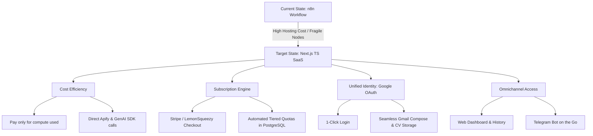
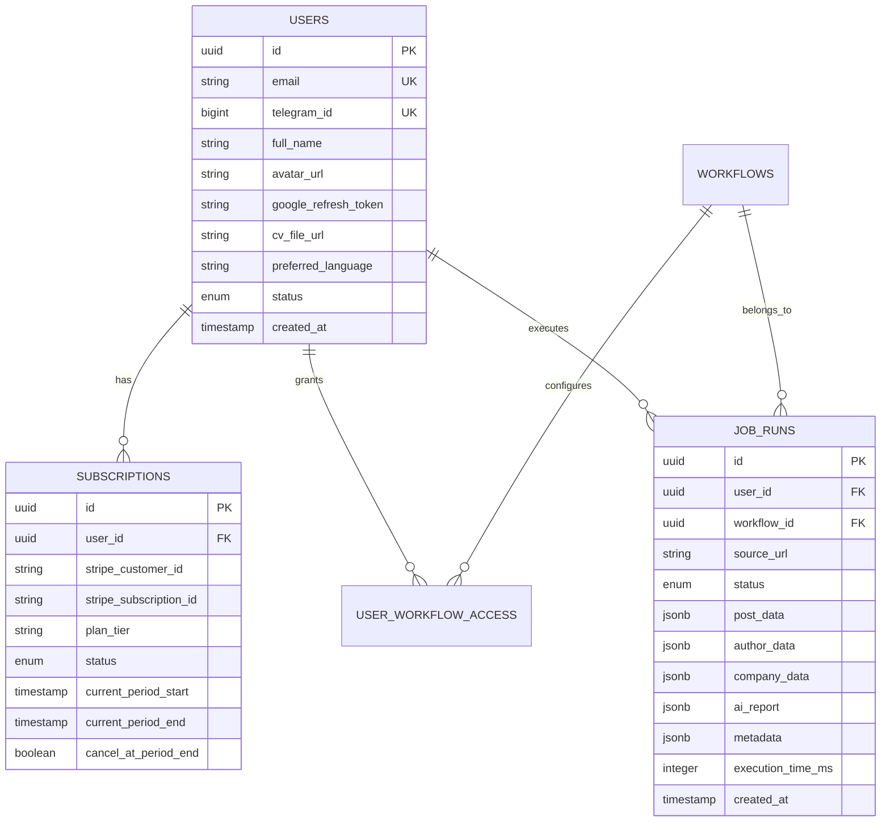
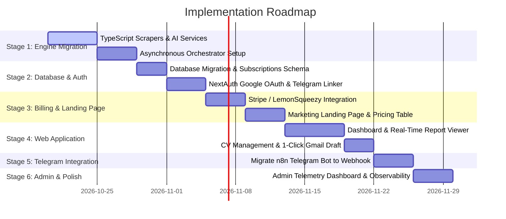

# 🌟 Project Vision & Architectural Blueprint: JobPost X-Ray SaaS

> **From n8n Automation to a Production-Grade Next.js TypeScript SaaS**  
> *Transforming LinkedIn recruitment intelligence into a high-performance, subscription-powered platform with dual-channel access (Web & Telegram).*

---

## 1. Executive Summary & Core Mission

### The Problem
Job seekers on LinkedIn face immense friction:
- **Information Overload:** Job posts are often long, unfocused, and miss critical context regarding the poster's actual role and the company's authentic background.
- **Lost Outreach Opportunities:** Recruiters frequently drop direct application emails inside post descriptions, but candidates either overlook them or delay applying because drafting personalized outreach emails with resume attachments is tedious.
- **Opaque Value of LinkedIn Premium:** LinkedIn Premium charges $40–$80/month for limited InMails that often go unread, without providing structured intelligence or automated workflow tools.

### The Solution: JobPost X-Ray
A single-click recruitment intelligence pipeline that accepts any LinkedIn post, job listing, or short link (`lnkd.in`), enriches it across three layers (post content, poster background, company profile), generates an AI-powered localized report (Arabic/English), and automatically prepares a personalized Gmail draft with the user's CV attached whenever a direct contact email is identified.

### The Strategic Shift
Migrating from the current **n8n workflow** to a **custom Next.js TypeScript backend**:
1. **Dramatically Lower Operating Costs:** Eliminate n8n cloud or dedicated VPS compute overhead and replace brittle visual node limits with optimized, serverless code.
2. **Superior Maintainability & Control:** Full TypeScript type safety, modular architecture, Git-based CI/CD, and programmatic error handling with fallback models.
3. **Commercial Scalability:** Introduce an integrated Stripe/LemonSqueezy subscription system, Google OAuth integration, user dashboards, and admin telemetry.
4. **Omnichannel Experience:** Enable users to trigger scans and receive reports both on the **Web Dashboard** and on the **Telegram Bot**, sharing one unified backend engine.

---

## 2. Core Drivers & Value Drivers



### 1. Cost Reduction & Performance Optimization
- **n8n Limitations:** Running continuous n8n workflows consumes high baseline memory (RAM) and can get expensive on managed n8n cloud tiers. Debugging complex JSON transformations in visual nodes becomes fragile as logic expands.
- **Next.js Advantage:** Direct execution of optimized Node.js / TypeScript code. Zero workflow engine overhead. SDKs communicate directly with Apify, Google Gemini, Anthropic, and PostgreSQL with connection pooling.

### 2. Maintainability & Agility
- Logic is centralized in modular TypeScript services (`/services/scraper`, `/services/ai`, `/services/email`, `/services/gatekeeper`).
- Prompts, fallback chains, and parsing rules are version-controlled, linted, and testable with unit tests.

### 3. Integrated Monetization
- Turn a private automation bot into a profitable B2C SaaS.
- Self-serve subscriptions: Users visit the landing page, pick a plan, authenticate with Google, link their Telegram (optional), and receive instant access with quotas managed automatically in the database.

---

## 3. User Journeys & Experience

### Journey 1: Landing Page & Onboarding
1. **Discovery:** User lands on a clean, modern landing page explaining the value proposition: *"Turn any LinkedIn job post into actionable intelligence and a ready-to-send email draft in 60 seconds."*
2. **Interactive Preview / Free Trial:** User can test 1 free scan on the landing page to experience the report quality.
3. **Checkout:** User selects a plan (e.g., Starter: 30 scans/mo, Pro: 100 scans/mo + Email drafting).
4. **Google Sign-In:** One-click authentication with Google OAuth, granting access to basic profile, email, and the restricted `gmail.compose` scope (for drafting).
5. **CV Setup:** User uploads their CV directly to the dashboard (or provides a Google Drive link).

### Journey 2: Job Analysis (Web Dashboard)
1. User pastes a LinkedIn URL in the dashboard search bar.
2. An interactive status stepper appears with real-time feedback:
   - `[✓] Verifying Link & Quota`
   - `[✓] Extracting Post Content`
   - `[✓] Enriching Recruiter & Company Insights`
   - `[⚡] Synthesizing AI Intelligence Report...`
3. The report is rendered with rich UI cards:
   - **Role Overview:** Title, seniority, key requirements, salary/location flags.
   - **Hiring Lead Profile:** Name, headline, estimated experience, educational pedigree.
   - **Company Pulse:** Size, industry, office locations, website.
   - **Application Action:** If an email is found: *"Draft an application email with 1 click"*.
4. Clicking **"Create Gmail Draft"** creates the draft inside their actual Gmail inbox with their CV attached, returning a direct link: *"Open Draft in Gmail"*.

### Journey 3: Job Analysis (Telegram Bot)
1. User connects their Telegram account in their web settings via a magic code (e.g., `/connect <TOKEN>`).
2. When on mobile, user shares/pastes a LinkedIn link directly to the Telegram bot.
3. The bot validates their subscription quota and streams status updates.
4. The bot returns the localized Markdown report with inline action buttons: `[ ✉️ Create Gmail Draft ]` or `[ 🌐 Open in Dashboard ]`.

### Journey 4: Admin & Analytics Dashboard
Admins have access to an administrative portal (`/admin`) to monitor:
- **Business Health:** Total users, active subscriptions, Monthly Recurring Revenue (MRR), churn rate.
- **Scraper & Cost Metrics:** Apify compute units consumed, average run duration, success vs. failure rates.
- **User Activity:** Top companies analyzed, top roles scanned, users nearing quota limits.
- **Manual Overrides:** Manually adjust user quota, grant complimentary access, unlock accounts.

---

## 4. System Architecture & Technical Design

### High-Level Architecture Diagram

```mermaid
flowchart TB
    subgraph ClientLayer["Client Layer (Frontend)"]
        Web[Next.js Web App / Dashboard]
        TG[Telegram Mobile App]
    end

    subgraph APILayer["Next.js Backend (App Router)"]
        SA[Server Actions / Dispatchers]
        TG_Webhook["Telegram Webhook (/api/telegram)"]
        Stripe_Webhook["Stripe Webhook (/api/billing/webhook)"]
        Auth[NextAuth / Auth.js - Google OAuth]
    end

    subgraph AsyncWorker["Background Execution Engine"]
        Queue["Orchestrator (Inngest / BullMQ / Serverless Worker)"]
    end

    subgraph ExtServices["External Services & APIs"]
        Apify[Apify LinkedIn Actors]
        Gemini[Google Gemini 2.0 Flash]
        Claude[Anthropic Claude Sonnet Fallback]
        GmailAPI[Google Gmail & Drive API]
        Stripe[Stripe / LemonSqueezy]
    end

    subgraph DataLayer["Storage & Database"]
        PG[(PostgreSQL / Supabase)]
        S3[(CV Cloud Storage / Supabase Storage)]
    end

    Web -->|Calls Server Action| SA
    TG -->|Incoming Message| TG_Webhook
    Stripe -->|Subscription Events| Stripe_Webhook
    
    SA -->|Validate Quota| PG
    SA -->|Dispatch Job| Queue
    TG_Webhook -->|Validate & Dispatch| Queue

    Queue -->|1. Scrape| Apify
    Queue -->|2. Analyze| Gemini
    Gemini -.->|Failover| Claude
    Queue -->|3. Save Result & Deduct Quota| PG
    
    Web -.->|Realtime Updates (SSE / Supabase)| PG
    Queue -.->|Push Telegram Message| TG

    SA -->|Create Draft| GmailAPI
    GmailAPI -->|Fetch CV| S3
```

---

### Key Architectural Decisions

#### 1. Why Server Actions Must Act as "Job Dispatchers", Not Synchronous Workers
As established in our technical analysis:
- Scraping a LinkedIn post, author, and company sequentially via Apify takes **60 to 90 seconds**.
- Running this synchronously in a single Server Action hits platform limits (Vercel 15s timeout on Hobby, 60s default on Pro; AWS API Gateway 29s timeout).
- **The Solution:** The Server Action `startJobAnalysis(url)` validates the user's quota, creates a `job_runs` record (`status: 'queued'`), dispatches the background task, and returns `{ jobId }` in **< 200ms**.
- The client streams progress via Supabase Realtime or Server-Sent Events (SSE).

#### 2. Authentication & Google Integrations: Smart OAuth Design
- **Old Approach:** User pastes a Google Drive link to their CV and manually configures credentials.
- **SaaS Approach:** 
  1. User logs in with **Google Sign-In**.
  2. Request the restricted scope `https://www.googleapis.com/auth/gmail.compose` (allows creating drafts without giving the app permission to read user emails).
  3. Allow users to **drag and drop their CV (PDF/DOCX)** directly into the Web Dashboard (stored securely in private Supabase Storage/S3). This eliminates broken Google Drive sharing permissions and simplifies UX.

---

## 5. Database Schema Evolution

Building on the existing [`schema.sql`](file:///e:/projects/Linkedin-job-X-ray/schema.sql), the database will be modernized for SaaS subscriptions:



### Proposed Schema Additions
1. **`users` Table Modernization:**
   - Add `email TEXT UNIQUE NOT NULL`, `avatar_url TEXT`, `google_refresh_token TEXT` (encrypted), `cv_storage_path TEXT`.
   - Make `telegram_id BIGINT` nullable, with a unique index where not null, allowing users to register on the web first and link Telegram later.
2. **`subscriptions` Table:**
   - Tracks Stripe customer ID, subscription status (`active`, `past_due`, `canceled`), current tier (`free`, `starter`, `pro`), and renewal dates.
3. **`job_runs` Table:**
   - Full history of user analyses. Caches scraped data so re-analyzing the same URL does not burn scraper credits.
   - Provides analytics for the Admin Dashboard.
4. **Enhanced Gatekeeper Function:**
   - Modified `authenticate_gatekeeper` that accepts either `p_user_id` (for web users) or `p_telegram_id` (for Telegram users).

---

## 6. Phased Implementation Roadmap

The project is structured into **6 clear, actionable stages**:



### Stage 1: Core Engine Migration (n8n -> TypeScript)
- Set up Next.js 15 project with TypeScript, Drizzle ORM / Prisma, and Tailwind CSS.
- Port all n8n logic into modular TypeScript services:
  - `lib/scrapers/apify.ts`: Direct calls to the 3 Apify actors with error handling and empty data checks.
  - `lib/ai/report-agent.ts`: Vercel AI SDK integration with Gemini 2.0 Flash as primary and Claude 3.5 Sonnet as fallback, enforced by Zod schema validation.
  - `lib/services/url-expander.ts`: Follow HTTP redirects for `lnkd.in` short URLs.
- Implement background orchestrator (using Inngest or Trigger.dev) to manage the multi-step scrape and report generation safely outside the HTTP timeout boundary.

### Stage 2: Database Evolution & Authentication
- Apply updated PostgreSQL migrations to Supabase/PostgreSQL.
- Set up NextAuth (Auth.js) with Google Provider:
  - Configure scopes for user profile and Gmail draft creation.
  - Encrypt and persist Google refresh tokens securely.
- Build Telegram Account Linking workflow: User generates a 6-digit code or deep link (`t.me/JobXrayBot?start=LINK_TOKEN`) to pair their Telegram account with their Web profile.

### Stage 3: Landing Page & Subscription Engine
- Build an aesthetic, high-converting landing page:
  - Hero section with live demo / sample report carousel.
  - Value calculator: Time saved vs. cost of LinkedIn Premium.
  - Transparent pricing table (Free Trial, Starter, Pro).
- Integrate Stripe / LemonSqueezy:
  - Checkout session creation via Server Action.
  - Webhook listener (`/api/billing/webhook`) handling `checkout.session.completed`, `customer.subscription.updated`, and `customer.subscription.deleted`.
  - Automatically update `user_workflow_access` quota upon successful payment or cycle renewal.

### Stage 4: Web Application & Interactive Dashboard
- Build modern, responsive dashboard UI:
  - Quick Search bar with URL validation regex.
  - Real-time analysis status stepper (listening to job progress).
  - Rich Markdown report renderer with bilingual layout support (LTR for English, RTL for Arabic).
  - Past analyses history table with search, role filters, and export options.
- Direct CV upload component (saving PDF to Supabase Storage/S3 bucket).
- 1-Click Gmail draft creation button invoking `createDraftAction`.

### Stage 5: Telegram Webhook Migration
- Decommission the n8n Telegram trigger node.
- Build Next.js Route Handler `/api/telegram/webhook`:
  - Receives Telegram updates (messages and callback queries).
  - Shares the exact same gatekeeper verification and background orchestrator used by the Web frontend.
  - Sends streaming status messages via Telegram Bot API (`editMessageText`).
  - Delivers the finalized Markdown report and inline buttons.

### Stage 6: Admin Dashboard & Observability
- Admin dashboard (`/admin`):
  - View real-time user registrations, active MRR, and plan distribution.
  - Monitor Apify actor execution times, failure rates, and token expenditures.
  - User management table: adjust quotas, inspect failed runs, and view user audit logs.
- Add Sentry error tracking and structured logging.

---

## 7. Product Validation & Market Viability Analysis

### Does It Solve a Real-World Problem?
**Yes, significantly.** Here is the validation breakdown:

1. **The "Silent Application" Dilemma:**
   Many recruiters post job opportunities as regular LinkedIn feed updates rather than official LinkedIn Job postings to avoid paying LinkedIn's expensive listing fees ($500+/month per post). These posts often contain instructions like *"Email your resume to careers@company.com with subject [Role Name]"*. Job seekers miss these or procrastinate because drafting a tailored cold email is high-friction. Automating the draft with their resume attached removes 90% of the friction.
2. **Ghost Jobs & Low-Quality Postings:**
   The AI report filters fluff, flags suspicious requirements, extracts authentic company statistics (headcount, real locations, industry), and provides insights into the poster's actual tenure and background.
3. **Bilingual Arabic/English Demand:**
   The MENA (Middle East & North Africa) tech and corporate market is one of the fastest-growing job markets globally. Having native, beautifully formatted Arabic (RTL) reports alongside English gives this product a distinct competitive moat in the Gulf and Arab region.

---

### Competitive Landscape & Market Positioning

| Solution | Price | Pros | Cons / Pain Points |
|---|---|---|---|
| **LinkedIn Premium** | $40–$80 / month | Native in-platform badges, profile views | Very expensive; InMails are frequently ignored; no email automation or deep analysis. |
| **Huntr / Teal / Simplify** | $10–$29 / month | Great job tracking and resume builders | Generalist tools; they don't perform 3-stage enrichment (post + author + company) or draft Gmail emails directly from feed posts. |
| **JobPost X-Ray** | **$9 – $19 / month** | **Instant 3-stage enrichment, automatic Gmail drafts with CV, Arabic & English, dual Telegram & Web access.** | Relies on third-party scrapers for LinkedIn data extraction. |

---

### Unit Economics & Gross Margins

Is the SaaS model profitable given the scraping and AI costs? Let's analyze the cost of goods sold (COGS) per job analysis:

| Component | Cost per Single Run | Notes |
|---|---|---|
| **Apify Post Scraper** | ~$0.008 | Lightweight post extraction |
| **Apify Author Scraper** | ~$0.004 | $4 per 1,000 runs (skipped if author is company) |
| **Apify Company Scraper** | ~$0.006 | Company profile actor |
| **Google Gemini 2.0 Flash** | ~$0.001 | ~12k tokens prompt + 1k tokens response |
| **Storage & Serverless Compute** | ~$0.001 | Next.js Serverless execution |
| **Total Cost Per Scan** | **~$0.020 (2.0 cents)** | Average blended cost per run |

#### Profit Margin Example (Pro Plan):
- **User Pays:** **$19.00 / month** for 100 scans.
- **Maximum COGS (100 scans x $0.020):** **$2.00**.
- **Payment Processing Fee (Stripe 2.9% + $0.30):** **$0.85**.
- **Net Gross Profit:** **$16.15 per user / month (~85% Gross Margin)**.

Even if an intensive user consumes all 100 scans, the gross margin remains exceptionally healthy.

---

## 8. Strategic Recommendations & Breakthrough Ideas

To ensure market differentiation and explosive growth, consider these strategic recommendations:

### 1. Direct CV Upload vs. Google Drive URLs
- **Current Friction:** In n8n, users have to upload their CV to Google Drive, change permissions to "Anyone with link can view", and copy the link. Users often misconfigure permissions.
- **Recommendation:** Allow users to upload their CV directly in the web dashboard (saved in private Supabase Storage/S3). When drafting an email, the backend attaches the file buffer directly. Google Drive can remain an optional alternate import source.

### 2. Multi-CV Persona Profiles
- Most job seekers have different CVs (e.g., *Frontend Engineer CV* vs. *Full-Stack Engineer CV*).
- Allow users to upload 2–3 resumes and select which one to attach by default, or let AI recommend which CV fits the extracted job description best.

### 3. AI Match & Fit Score (Instant Upsell Feature)
- Before creating the email draft, have the AI compare the candidate's uploaded CV with the scraped job requirements.
- Deliver a **"Fit Score" (e.g., 85% Match)** highlighting:
  - Strong matching skills.
  - Missing keywords you should emphasize in your interview.

### 4. Chrome Extension Companion (Phase 2 Expansion)
- Build a lightweight Chrome extension that injects a small floating button onto any LinkedIn job post: *"Analyze with JobPost X-Ray"*.
- Clicking it opens the web app or sends the report directly to their Telegram bot in the background.

---

## 9. Conclusion & Next Steps

This transition from an n8n automation into a standalone Next.js TypeScript SaaS transforms a personal utility into an enterprise-ready, scalable business. 

The project has:
- **A proven, working workflow** already established in logic and database rules.
- **Strong unit economics** with ~85% gross margins.
- **High market utility** addressing clear job-hunting friction.

When you are ready to begin development, we will start with **Stage 1: Core Engine Migration** by establishing the Next.js project structure, typed scrapers, and background orchestrator.
